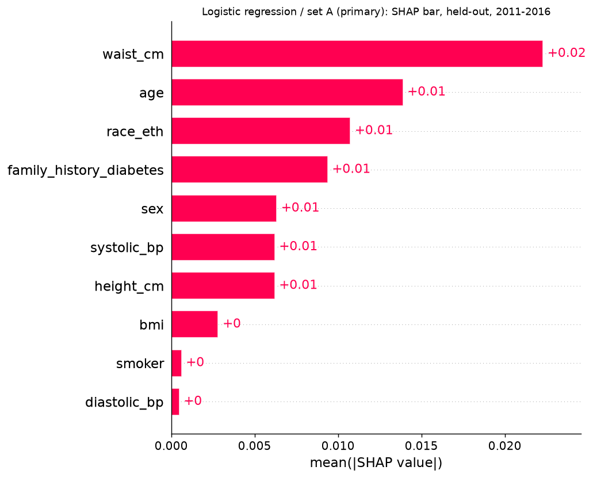
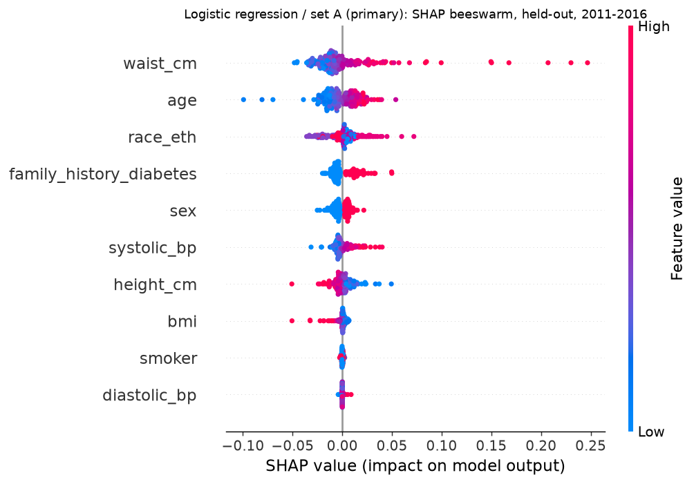
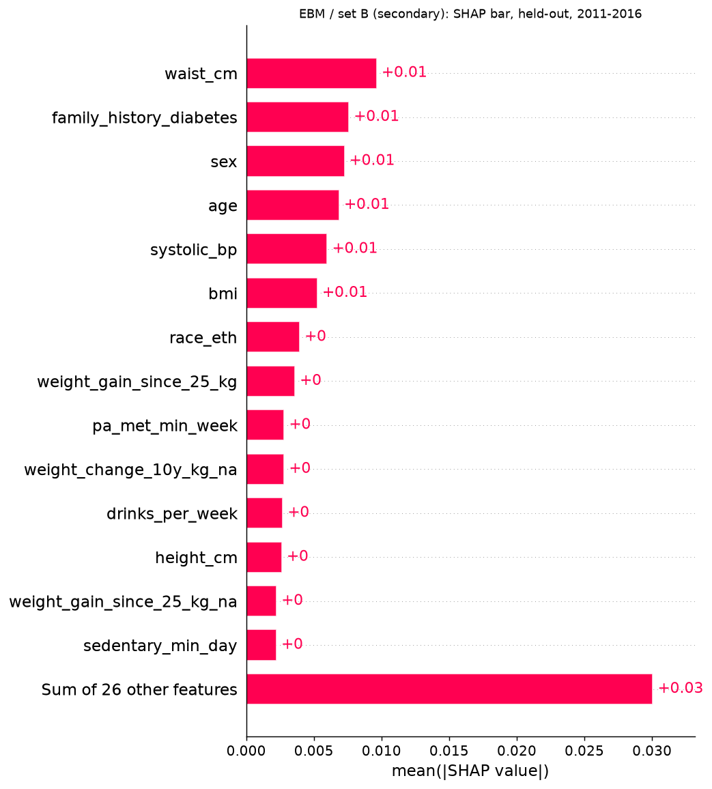
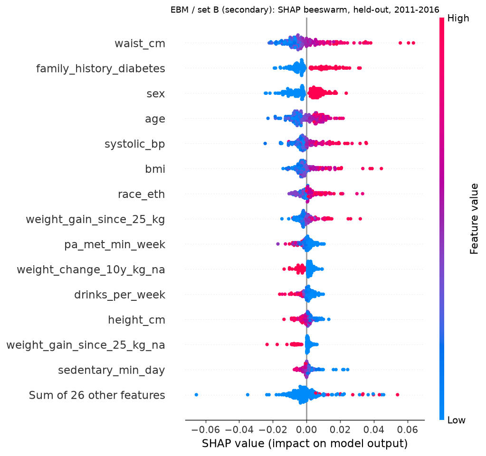
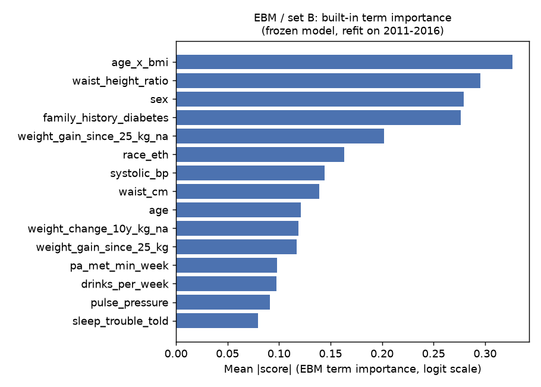
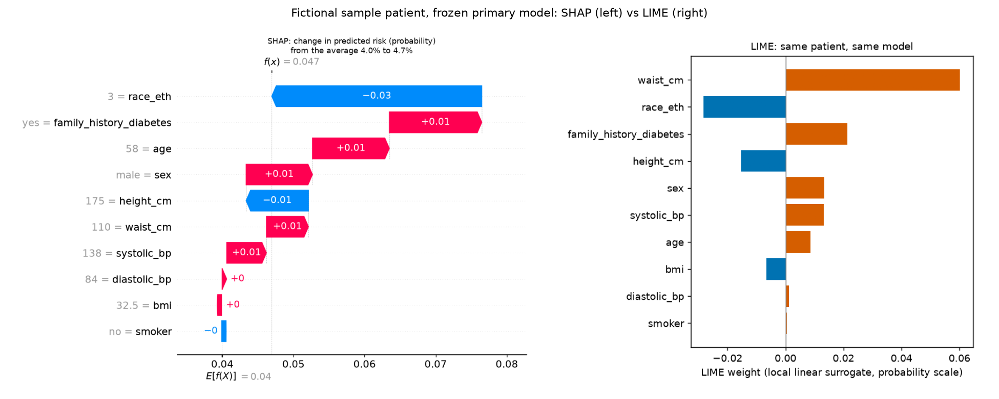

# GlucoSense-AI

Screening for **undiagnosed diabetes** in US adults from information collected without a
blood test.

> **Summary**
>
> - **Question:** can routine, non-laboratory information find adults who have diabetes but
>   don't know it (HbA1c ≥ 6.5 %, no diagnosis)?
> - **Data:** NHANES. Development: 2011-2016 (n = 13,189; 410 positives). One temporal test:
>   2017-2018 (n = 4,095; 157 positives). Rules fixed in advance in `docs/analysis_plan.md`.
> - **Primary model:** L2 logistic regression on 10 inputs (age, sex, BMI, waist, height,
>   systolic and diastolic BP, family history of diabetes, ever smoked, race/ethnicity), chosen
>   by pre-specified rules, frozen at the tag `pre-test` and scored once.
> - **Test result (95 % bootstrap CI):**
>   - ROC-AUC **0.780** (0.749-0.811), against 0.805 in development.
>   - PR-AUC **0.107** (0.085-0.139), at a prevalence of 3.8 %.
>   - Calibration slope **0.89** (0.76-1.02), O/E **0.98** (0.84-1.13).
>   - Better than an ADA-style score: ROC-AUC +0.063 (0.040-0.087).
>   - Net benefit above treat-all at every threshold from 1 % to 5 %.
> - **Caveats:**
>   1. **2017-2018 was not untouched.** An earlier v1 model scored it once before the plan
>      existed. No v2 decision used that result.
>   2. **The model was worse for men than for women in the test only.** ROC-AUC was 0.730 for
>      men and 0.819 for women, a difference of +0.089 (0.022-0.154). In development the sexes
>      were alike (−0.002, −0.036 to 0.034). This was found after scoring and rests on 67 male
>      positives.
> - **Try it:** `python scripts/demo.py` (see [Demo](#demo-one-command-no-data-download)).
>   Model card: [`docs/model_card.md`](docs/model_card.md). Reporting checklist:
>   [`docs/tripod_ai_checklist.md`](docs/tripod_ai_checklist.md).
>
> Research only; not a medical device.

## Study design (v2)

- **Data:** NHANES 2011-2012, 2013-2014 and 2015-2016 for development. 2017-2018 is held out
  for one temporal test.
  - **Lab values** are used only to build labels, and **survey weights** only for prevalence and
    weighted secondary metrics. Neither is ever a feature.
- **Analysis sample:**
  - adults ≥ 20 years with HbA1c measured, not pregnant, and no self-reported diagnosis
    (DIQ010 not 1, 7 or 9; borderline kept);
  - not taking insulin or diabetes pills.
- **Main label:** HbA1c ≥ 6.5 %. The sensitivity label (HbA1c ≥ 6.5 % or FPG ≥ 126 mg/dL, fasting
  subsample, with FPG back-adjusted for the 2015 analyser change) is used in a secondary analysis
  only.
- **Prevalence, development:** 3.1 % unweighted, 2.1 % weighted (WTMEC2YR/3).
- **Feature sets:** nested, A ⊂ B ⊂ C, plus D for sensitivity only.
  - **A (10):** the inputs above.
  - **B (+30):** activity, sleep, smoking, alcohol, diet, hypertension, gestational diabetes and
    weight history.
  - **C (+3):** education, income and food security.
  - **D (+4):** healthcare access.
- **Models:** L2 logistic regression, XGBoost, MLP and EBM on every set. Rebalancing variants and
  TabNet run on set A only. The ADA-style score is a comparator.
- **Validation:**
  - nested CV (5 outer folds × 3 repeats, inner 3-fold tuning);
  - leave-one-cycle-out;
  - paired model and set comparisons with Nadeau-Bengio intervals;
  - then the single 2017-2018 test.
- **Selection rules** (pre-specified): the primary set, then the primary model, chosen on PR-AUC
  with a simplicity tie-break. Result: set A, logistic regression.
- **Metrics:**
  - PR-AUC (primary), ROC-AUC, Brier;
  - calibration slope, intercept and O/E;
  - decision curves over 1-5 %;
  - subgroups by sex and race/ethnicity;
  - survey-weighted versions.
- **Explanations** (exploratory, development only): SHAP vs LIME agreement, stability, DiCE
  counterfactuals.
- **External validation (BRFSS):** **future work, not done.** `src/data/brfss.py` is an unused
  loader. BRFSS has no labs, so it can test only self-reported diabetes, a different outcome.

## Demo (one command, no data download)

```bash
pip install -r requirements.txt
python scripts/demo.py                                # scores the fictional examples/sample_patient.json
python scripts/demo.py --patient my_patient.json      # your own 10 set-A inputs
```

The demo uses `models/primary_logreg_A.json`, a portable copy of the frozen primary model:
aggregate parameters and coefficients only, with no NHANES records.
- `scripts/export_demo_model.py` wrote it from the saved model, after checking the model's
  sha256 against the test run log.
- On all 12,240 complete development rows its predictions match the original to 1e-16.
- It needs every numeric input.

It is a research demo, not a diagnosis. See `docs/model_card.md`, `docs/tripod_ai_checklist.md`
and `LICENSE`, which covers the code only (MIT); NHANES data are public and not redistributed.

## Reproduce the v2 study

```bash
python -m venv .venv && source .venv/bin/activate   # Windows: .venv\Scripts\activate
pip install -r requirements.txt
python -m src.data.nhanes --download                 # builds 2011-2016 only (refuses 2017-2018)
python scripts/run_dev.py                            # nested CV, sets A-D, LOCO, selection rules
python scripts/dev_subgroups.py                      # subgroups (sex, race/ethnicity), development
python scripts/dev_dca.py                            # decision curves, development
python scripts/dev_weighted.py                       # survey-weighted metrics, development
python scripts/dev_explain.py --stage fit,shap       # explanations (SHAP, LIME, stability)
python scripts/dev_explain.py --stage dice           # DiCE counterfactuals
python scripts/dev_sex_gap.py                        # women vs men, development (exploratory)
# the single 2017-2018 temporal test (plan section 9): ALREADY RUN, do not rerun
python -m src.data.nhanes --test                     # builds 2017-2018 alone, same rules
python scripts/run_test.py --stage fit               # 2011-2016 only: refit, hashes, run log
python scripts/run_test.py --stage score             # refuses unless tree clean, tag pre-test, hashes match
python scripts/post_test_exploratory.py              # post-test exploratory, from saved predictions
```

Every development combination is checkpointed with a hash of its data, settings and features,
and skipped on restart when the hash matches.

## Layout

```
configs/            experiment settings (feature sets, CV, seeds)
docs/               analysis plan (the rules), feature audit, model card, TRIPOD+AI checklist
src/data/           NHANES build (labels, exclusions, derived features); BRFSS loader (unused)
src/preprocessing/  leakage-safe pipeline: KNN/mode imputation, RobustScaler, encoders
src/models/         model wrappers, ADA-style score, portable JSON model
src/evaluation/     nested CV, LOCO, selection rules, metrics, DCA, subgroups
src/explain/        SHAP, LIME, DiCE analysis
src/app/            v1 prototype (FastAPI + Streamlit), not wired to the v2 model
scripts/            entry points (above); demo.py
models/, examples/  portable demo model and a fictional sample patient
results/            committed results (aggregates and predictions; no NHANES records)
tests/              synthetic-data tests (no downloads needed)
```

## Results: development (2011-2016) and the single 2017-2018 temporal test

> **2017-2018 was not untouched.** Before this analysis plan existed, the old v1 pipeline scored
> an XGBoost model on 2017-2018 once (commit `df1b305`: PR-AUC 0.101, ROC-AUC 0.776, prevalence
> 3.8 %). No v2 selection rule used that result. The test below is the first and only scoring of
> the pre-specified v2 model, but not the first look at the cycle (deviation 2026-11-02 in
> `docs/analysis_plan.md`).

Pre-specified in `docs/analysis_plan.md` (section 9 and the deviations). The test was scored
**once** from the commit tagged `pre-test` (`6795066`); its results are in
`results/test_2017_2018/` (commit `befb8b1`), with every hash in `run_log.json`. The primary
model is L2 logistic regression on set A (10 inputs, one-hot categoricals), refit on all of
2011-2016 (C = 0.3) and **not recalibrated**.

**Primary model, unweighted (primary result).** Test values have bootstrap 95 % intervals (1000
resamples, seed 42). Development values are means over the 15 nested-CV folds; LOCO is the
2015-2016 held-out cycle, the closest development analogue.

| Metric | Dev nested CV | Dev LOCO 2015-16 | **Test 2017-18** |
|---|---|---|---|
| n (positives), prevalence | 13,189 (410), 3.1 % | 4,294 (127), 3.0 % | **4,095 (157), 3.8 %** |
| PR-AUC | 0.104 | 0.079 | **0.107 (0.085-0.139)** |
| PR-AUC / prevalence | 3.3 | 2.7 | **2.8** |
| ROC-AUC | 0.805 | 0.773 | **0.780 (0.749-0.811)** |
| Brier | 0.029 | 0.029 | **0.036 (0.031-0.041)** |
| Calibration slope | 1.00 | 0.83 | **0.89 (0.76-1.02)** |
| Calibration intercept | 0.01 | −0.73 | **−0.33 (−0.74 to 0.05)** |
| O/E | 1.00 | 0.79 | **0.98 (0.84-1.13)** |

Discrimination dropped from development (ROC-AUC 0.805 → 0.780), to about the level the
2015-2016 LOCO predicted, as section 9 expected. Calibration-in-the-large held (O/E 0.98). The
slope of 0.89 points to slightly too-extreme risks, but its interval includes 1. PR-AUC is higher
than in development only because prevalence is higher; relative to prevalence it fell (3.3 → 2.8).

**Secondary results (labelled; none replaces the primary result).**

| Model / version | Dev PR-AUC / ROC-AUC | Test PR-AUC | Test ROC-AUC | Test O/E |
|---|---|---|---|---|
| Primary, survey-weighted (WTMEC2YR) | 0.088 / 0.844 (prev 2.1 %) | 0.082 (0.063-0.114), prev 2.5 % | 0.799 (0.751-0.846) | — |
| Primary, intercept-recalibrated on the test | — | 0.107 (unchanged) | 0.780 (unchanged) | 1.00 by construction |
| EBM / set B | 0.112 / 0.800 | 0.114 (0.090-0.151) | 0.781 (0.747-0.812) | 1.10 (0.94-1.27) |
| ADA-style score (comparator) | 0.079 / 0.749 | 0.072 (0.058-0.087) | 0.717 (0.680-0.752) | 1.03 (0.87-1.19) |

- **Recalibration:** the recalibration intercept was −0.02. It changed Brier only in the fourth
  decimal (0.0360 → 0.0359) and net benefit by less than 0.001, so a local intercept update is not
  needed.
- **EBM / B:** it adds 30 questionnaire inputs, but on the test it is no better than the primary
  model. Its alcohol items were left missing and imputed, because the 2017 questionnaire changed.
- **ADA-style score:** both models beat it on every discrimination metric.

**Decision curve (1-5 %, `test_dca.csv/.png`).** The primary model's net benefit is above
treat-all at every threshold from 1 % to 5 %, and the paired bootstrap band of the difference
excludes 0 throughout.

| Threshold | Net benefit − treat-all, test (95 % band) | Dev (out-of-fold) |
|---|---|---|
| 1 % | 0.0027 (0.0026-0.0029) | 0.0026 |
| 2 % | 0.0050 (0.0029-0.0070) | 0.0080 |
| 3 % | 0.0107 (0.0080-0.0134) | 0.0141 |
| 5 % | 0.0249 (0.0212-0.0287) | 0.0286 |

**Subgroups, primary model (`test_subgroups_logreg__none__A.csv`).**

| Group (positives) | PR-AUC | ROC-AUC | Slope | O/E |
|---|---|---|---|---|
| Women (90) | 0.151 (0.112-0.218) | 0.819 (0.782-0.853) | 1.04 | 1.14 (0.91-1.37) |
| Men (67) | 0.075 (0.054-0.107) | 0.730 (0.675-0.789) | 0.70 (0.53-0.93) | 0.83 (0.64-1.00) |
| Non-Hispanic Black (54) | 0.137 | 0.743 (0.678-0.806) | 0.73 | 1.07 (0.81-1.33) |
| Other groups (8-28 each) | flagged unreliable (< 30 positives) | | | |

**Post-test findings** (seen only after scoring; reported, nothing was rerun or changed):
1. **Men vs women.** Discrimination and calibration slope are clearly worse in men on the test
   (ROC-AUC 0.73 vs 0.82, slope 0.70). In development the two sexes were alike (ROC-AUC 0.805
   vs 0.803, slopes 1.04 and 0.97). This was not expected, and it rests on 67 male positives.
2. **Race/ethnicity cannot be checked on the test.** Only non-Hispanic Black adults reach 30
   positives. So the development fix for calibration by race/ethnicity is not confirmed or
   refuted on 2017-2018.
3. **The recalibrated O/E interval is degenerate (1.00-1.00).** The intercept is re-estimated in
   every resample, which forces O/E to 1. This is a property of the method, not a result.
4. **PR-AUC is not comparable across prevalences.** Read it against prevalence; the ratio fell.

**Post-test, exploratory, not used for any decision** (`scripts/post_test_exploratory.py`,
`results/post_test_exploratory/`). These were computed from the saved test predictions only, with
no model fitted, refitted or rescored. Bootstrap: 1000 resamples, seed 42.

| Comparison | Difference | 95 % CI |
|---|---|---|
| Primary − ADA-style, ROC-AUC (unweighted) | 0.063 | 0.040 to 0.087 |
| Primary − ADA-style, PR-AUC (unweighted) | 0.035 | 0.023 to 0.057 |
| Primary − ADA-style, ROC-AUC (weighted) | 0.072 | 0.036 to 0.109 |
| Primary − ADA-style, PR-AUC (weighted) | 0.034 | 0.019 to 0.061 |

**Women vs men, primary model.** The development column (`scripts/dev_sex_gap.py`,
`results/dev_cv_v2_sex_gap/`) uses nested-CV out-of-fold predictions on 2011-2016 only, with the
same within-sex bootstrap as the test.

| | Dev 2011-2016 (out-of-fold) | Test 2017-2018 |
|---|---|---|
| Positives: women / men | 195 / 215 | 90 / 67 |
| ROC-AUC, women | 0.803 (0.774-0.828) | 0.819 (0.783-0.856) |
| ROC-AUC, men | 0.805 (0.783-0.828) | 0.730 (0.674-0.782) |
| **ROC-AUC, women − men** | **−0.002 (−0.036 to 0.034)** | **+0.089 (0.022 to 0.154)** |
| PR-AUC, women | 0.092 (0.074-0.119) | 0.151 (0.110-0.222) |
| PR-AUC, men | 0.105 (0.085-0.135) | 0.075 (0.054-0.108) |
| **PR-AUC, women − men** | **−0.013 (−0.050 to 0.020)** | **+0.077 (0.025 to 0.150)** |
| Calibration slope, women − men | −0.07 (−0.24 to 0.10) | +0.34 (0.06 to 0.63) |

In development there was no gap between women and men; it appeared only in 2017-2018.

- **Calibration by sex:** O/E was 1.14 for women (0.90–1.37) and 0.83 for men (0.64–1.02).
- **In men:** predicted risks in the top fifth averaged 11.7 %, against 8.2 % observed, so risks were too high at the top. In the second fifth they were 1.3 % predicted against 2.8 % observed, so too low at the low end.
- **In women:** the top fifth was slightly underestimated (10.9 % predicted vs 13.5 % observed).
- **Caution:** this rests on 67 male and 90 female positives, and it was looked for only after the results were seen.

**Set-A inputs in the 2017-2018 codebooks.** This was checked after the test, so any difference
would be a post-test finding; none was found, and nothing was rerun.

- **Codebooks compared:** the CDC NHANES documentation for DEMO, BMX, BPX, MCQ and SMQ, 2017-2018
  (`_J`) against 2011-2012 (`_G`); for MCQ300C also 2013-2014 (`_H`) and 2015-2016 (`_I`).
- **Raw files:** the 2017-2018 files hold the same variable names as the development files. Only
  the column names were read, not the values.

| Input | NHANES variable | 2017-2018 vs 2011-2016 |
|---|---|---|
| age | RIDAGEYR | Same; top-coded at 80 in both |
| sex | RIAGENDR | Same codes (1 male, 2 female) |
| race/ethnicity | RIDRETH3 | Same codes (1, 2, 3, 4, 6, 7; no 5) |
| BMI, waist, height | BMXBMI, BMXWAIST, BMXHT | Same names and units (kg/m², cm) |
| systolic, diastolic BP | BPXSY1-4, BPXDI1-4 | Same names, same 3 (+1) reading protocol; a diastolic of 0 is a valid value in both |
| family history | MCQ300C | Same question, codes (1 yes, 2 no, 7, 9) and target (20+); the codebook writes the name `MCQ300c` in every cycle |
| ever smoked 100 cigarettes | SMQ020 | Same question and codes. The target age is 18+ in 2017-2018 and 20+ in 2011-2012, which doesn't matter because the sample is 20+ |

- **Not checked:** the set-B codebooks beyond the alcohol redesign (see Limitations).
- **Known limitation, same in every cycle:** systolic and diastolic BP are means of the available
  readings, and a diastolic reading of 0 enters that mean unchanged.

## Explainability results (development only, exploratory)

These come from `results/dev_cv_v2_explain/` (`scripts/dev_explain.py`; method in the plan,
deviation 2026-11-02 B). They are explanations of the model, not of what causes diabetes.

**SHAP vs LIME agreement**, from held-out explanations of 204 patients (17 per race/ethnicity ×
sex cell). Values are means with bootstrap 95 % CIs.

| | Logistic regression / A (primary) | EBM / B (secondary) |
|---|---|---|
| Top-5 overlap | 0.86 (0.85-0.88) | 0.49 (0.47-0.51) |
| Spearman, \|SHAP\| vs \|LIME\| | 0.86 (0.85-0.87) | 0.62 (0.61-0.63) |
| Range across race/ethnicity × sex groups | 0.83-0.90 overlap | 0.48-0.52 overlap |

**Stability of global SHAP importance**, as the mean pairwise Spearman between models:

| | Logistic regression / A | EBM / B |
|---|---|---|
| 15 outer-fold models | 0.96 (0.94-0.96) | 0.84 (0.83-0.85) |
| 3 leave-one-cycle-out models | 0.92 (0.91-0.94) | 0.72 (0.70-0.74) |

For the primary model, the ranking is waist (1st in every model), age (2nd), race/ethnicity and
family history (3rd-4th), then sex, height and systolic BP. BMI, smoking and diastolic BP come
last. With 40 inputs, EBM's explanations are less stable: SHAP and LIME agree only on about half
of the top 5.

**DiCE counterfactuals.** These are 20 patients with predicted risk ≥ 3 %, with 3
counterfactuals each that bring the predicted risk below 3 %. Age, sex, height, race/ethnicity,
family history and smoking were held fixed.

| | Logistic regression / A | EBM / B |
|---|---|---|
| Found / requested | 60 / 60 | 60 / 60 |
| Validity (rescored < 3 %) | 100 % | 100 % |
| Sparsity (features changed, mean) | 1.6 | 1.8 |
| Proximity (mean change in training MADs) | 4.8 | 27.7 |
| All changed values within the training 1st-99th percentile | 37 % | 12 % |
| No change to unchangeable history items | 100 % | 48 % |
| **Plausible (both of the above)** | **37 %** | **7 %** |

**Most counterfactuals are not realistic.** They always reach the target and change only one or
two inputs. But 63 % (logistic regression) and 93 % (EBM) need changes that fall outside the
range seen in training, or rewrite the patient's history.
- One example cuts waist from 120 cm to 67 cm.
- Another sets diastolic BP to 2 mmHg.

They show what the model responds to; they are not advice for any person.

### Figures

`scripts/dev_figures.py` makes these from development data only (2011-2016); 2017-2018 is never
loaded. **All of these explain how the model uses its inputs. None of them shows cause and effect:**
an input with a large bar is one the model leans on, not necessarily one that causes diabetes, and
changing it in a real person may not change their risk.

**Global SHAP, primary model (logistic regression / set A).** These are held-out explanations of
the 204 sampled patients, each explained by the outer-fold model that did not train on them.



*The average size of each input's effect on the predicted risk. Waist matters most, then age,
race/ethnicity and family history. Smoking and diastolic BP barely move the prediction.*



*Each dot is one patient. Right of zero means the input raised that patient's predicted risk; red
means a high value of the input.*
- A larger waist, older age, a family history and higher systolic BP push risk up.
- With waist held fixed, a greater height and a higher BMI push it slightly down. These inputs are
  strongly linked to waist, so this is how the model splits their shared signal, not a protective
  effect.
- For race/ethnicity, sex, family history and smoking the colour is just a category code, not
  "high" or "low".

**Global SHAP, secondary model (EBM / set B, 40 inputs).**





*EBM spreads its effect over many inputs. Waist, family history, sex, age, systolic BP and BMI
lead, and the 26 inputs not shown add up to more than any single one. The ranking is less stable
across folds than for the primary model (see the table above).*

**EBM's own feature importance.** This is from the frozen EBM / B, refit on all of 2011-2016.



*EBM's built-in measure: the average absolute contribution of each term, on the log-odds scale.
EBM sees the four derived terms (age × BMI, waist/height, pulse pressure, BMI/age), so they appear
here, while the SHAP plots group everything back into the original inputs. Both views put body
size, sex and family history near the top.*

**One patient: SHAP vs LIME.** This is the fictional sample patient (`examples/sample_patient.json`:
58-year-old man, BMI 32.5, waist 110 cm, BP 138/84, family history yes) under the frozen primary
model. The predicted risk is 4.7 %, against an average of 4.0 % over 100 development rows.



*Left, SHAP: how each input moves this patient's risk away from the average. Right, LIME: the
weights of a simple model fitted around this patient.*
- **Where they agree:** family history, age, male sex and systolic BP raise his risk; his
  race/ethnicity (non-Hispanic White, code 3) and his height lower it. That race/ethnicity effect
  is relative to the other groups in the training data; it is not biological.
- **Where they differ:** LIME gives waist far more weight than SHAP does (+0.060 vs +0.006). LIME
  compares broad bins of each input, while SHAP compares against real background patients, so
  local explanations can disagree even for a simple model.

**One patient: DiCE counterfactuals** (`docs/figures/dice_sample_patient.csv`). These are input
changes that would bring the same patient's predicted risk below 3 %. Age, sex, height,
race/ethnicity, family history and smoking were held fixed; blank cells are unchanged.

| Input | Original | Counterfactual 1 | Counterfactual 2 | Counterfactual 3 |
|---|---|---|---|---|
| BMI | 32.5 | | **30.6** | **37.8** |
| Waist (cm) | 110 | | **85.8** | **98.4** |
| Systolic BP (mmHg) | 138 | **69.8** | | |
| Diastolic BP, age, sex, height, family history, smoker, race/ethnicity | unchanged | | | |
| **Predicted risk** | **4.7 %** | 2.0 % | 1.5 % | 2.6 % |
| Within the training 1st-99th percentile? | | **No** (systolic 92.7-178) | Yes | Yes |
| Realistic? | | **No:** a systolic of 70 is hypotension, not a goal | **No:** 24 cm off the waist for only 2 BMI units | **No:** BMI rises by 5 while the waist shrinks by 12 cm |

*None of the three is realistic, although two pass the range check. DiCE changes inputs
independently, so it can pair values that don't occur together in one body. This is why the
range check overstates plausibility (37 % in the summary above). Counterfactuals show what the
model is sensitive to; they are not a plan for any patient.*

## Notes on honesty

- Counterfactuals are model explanations, not causal advice.
- SMOTE-NC distorts probabilities; the calibration cost is reported, not hidden.
- Nested CV reduces optimistic bias; it does not remove it.
- SDs across repeated CV folds are not independent: training sets overlap, so they understate
  the uncertainty. Reported SDs describe spread, not standard errors. Model and set differences
  are compared on identical folds with the Nadeau-Bengio corrected 95 % interval instead.

## Limitations (draft)

- **Survey design not modelled.** Models are trained and scored unweighted on the NHANES
  sample. Survey weights (WTMEC2YR) enter only prevalence and a weighted sensitivity analysis of
  ROC-AUC and PR-AUC; the strata and PSUs (SDMVSTRA, SDMVPSU) are not used at all.
- **Intervals are too narrow.** Bootstrap intervals resample persons independently, ignoring
  strata and PSUs, so they understate the uncertainty. SDs across repeated CV folds are not
  independent either (see above).
- **Sample vs population prevalence.** In the 2011-2016 development data the main label has a
  prevalence of 3.1 % unweighted but 2.1 % weighted. Unweighted PR-AUC, PPV and net benefit
  describe the NHANES sample, not the US adult population; read weighted PR-AUC against 2.1 %.
- **Calibration by race/ethnicity: the gap came from an encoding error.** Logistic regression
  first received race/ethnicity (and, in sets B-D, smoking and drinking status) as one ordinal
  code, so it fitted a single slope across nominal groups. The development subgroup analysis
  exposed it; it was fixed by one-hot encoding before the test (docs/analysis_plan.md,
  Deviations 2026-11-02), and the selection rules, applied again, still pick logistic
  regression on set A. Out-of-fold O/E for that model (95 % bootstrap CI, 1000 resamples within
  group; old results in `results/archive_v2_ordinal_logreg/`):

  | Group (positives) | O/E, ordinal (before) | O/E, one-hot (after) |
  |---|---|---|
  | Non-Hispanic White (94) | 0.59 (0.48-0.71) | 0.97 (0.79-1.17) |
  | Non-Hispanic Asian (65) | 1.66 (1.31-2.08) | 1.04 (0.82-1.30) |
  | Non-Hispanic Black (116) | 1.15 (0.96-1.37) | 1.00 (0.83-1.19) |
  | Mexican American (72) | 1.37 (1.06-1.68) | 1.01 (0.78-1.24) |
  | Other Hispanic (53) | 1.28 (0.96-1.64) | 1.02 (0.77-1.30) |
  | CI includes 1 | 2 of 5 groups | 5 of 5 groups |
  | Nested-CV PR-AUC / ROC-AUC (all) | 0.094 / 0.783 | 0.104 / 0.805 |

  "Other / multiracial" (10 positives) is too small to judge. The intervals are wide (about 20-25 %
  either side) and ignore the survey design, so this shows the gross
  miscalibration is gone, not that calibration is equal across groups. Group-wise
  recalibration was dropped as no longer needed. The MLP also received ordinal codes and was
  not refit; it is never the primary model.
- **2017-2018 was not untouched.** Before the analysis plan, the v1 pipeline scored XGBoost on
  2017-2018 once (commit `df1b305`: PR-AUC 0.101, ROC-AUC 0.776, prevalence 3.8 %, v1 rules). No
  selection rule used it, but the cycle's prevalence and one model's performance were known.
- **Test item mapping.** The 2017 alcohol questionnaire was redesigned, so the three alcohol
  items are missing on the test and were imputed (this affects EBM / B only). The 10 set-A
  inputs were checked against the 2017-2018 codebooks after the test, and no difference was found
  (see Results). The other set-B items keep their 2011-2016 names, and their codes were assumed
  unchanged without re-checking every codebook.
- **One test cycle, small subgroups.** 157 test positives; only one race/ethnicity group
  reaches 30, and the men-vs-women difference rests on 67 male positives.
- **Label based on HbA1c only.** The main label is HbA1c ≥ 6.5 % from a single measurement, with
  no confirmatory test. HbA1c misses some cases that fasting glucose or an OGTT would find, and
  differs by race/ethnicity and with anaemia or haemoglobin variants. HbA1c-or-FPG on the
  fasting subsample is a sensitivity analysis only.

## Earlier v1 design (superseded)

The repository began as a v1 prototype. It is kept for the record and is **not** the v2 study
above.
- **Design:** NHANES 2011-2018 as one pool; XGBoost, PyTorch MLP and TabNet as the main models;
  set A only; nested 5-fold CV; a temporal XGBoost run on 2017-2018.
- **That temporal run:** it predates the plan (see caveat 1 in the summary). Its result is in
  `results/temporal_test.csv` (commit `df1b305`).
- **Not done:** BRFSS external validation was planned in v1 but never run (future work).
- **The app in `src/app/` is a v1 prototype:**
  - The FastAPI service and the Streamlit dashboard load `models/pipeline.joblib`, which no v2
    script writes, so as committed they report that no model is loaded.
  - The dashboard also uses a tree explainer that does not fit the v2 logistic regression.
  - For v2 scoring, use `scripts/demo.py`.

v1 commands, kept as a record:

```bash
python scripts/run_experiment.py --config configs/config.yaml --n-iter 5     # v1 nested CV, set A
python scripts/run_experiment.py --models logreg,ada_style --strategies none --n-iter 5
python scripts/summarize_dev_cv.py                                           # results/dev_cv_summary.csv
python scripts/run_experiment.py --mode temporal --models xgboost --strategies none   # v1 temporal run
uvicorn src.app.api:app --reload        # v1 prototype API (needs models/pipeline.joblib)
streamlit run src/app/dashboard.py      # v1 prototype dashboard (tree models only)
```